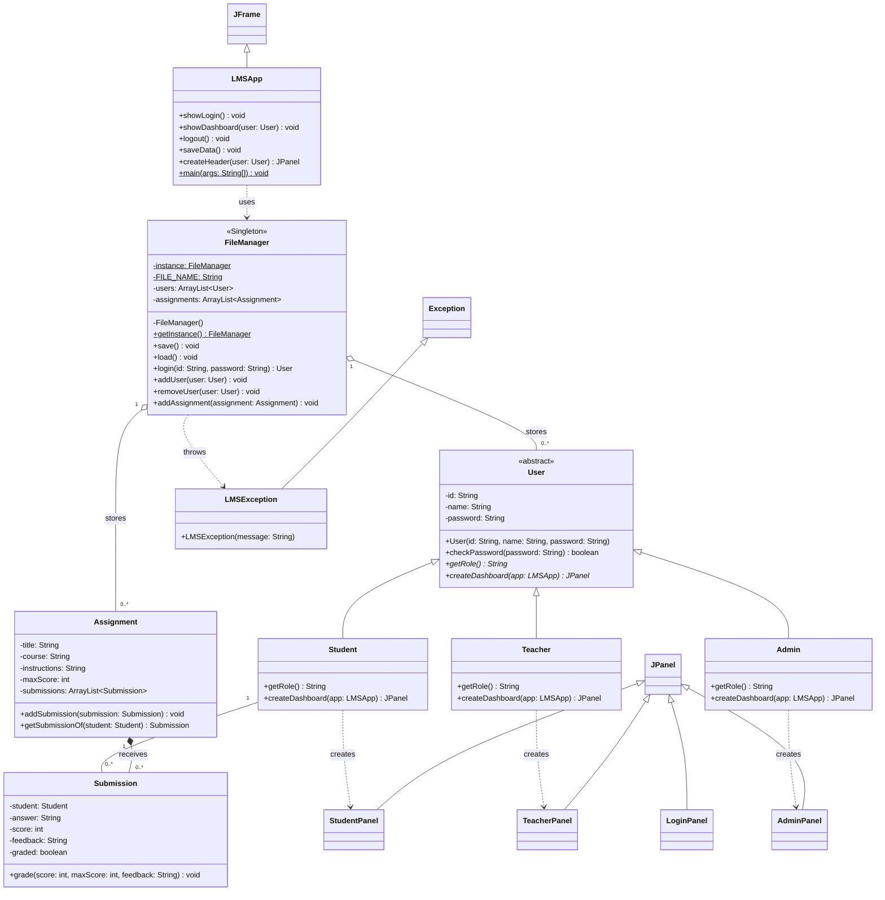

# Simple LMS — UML Class Diagram

GitHub draws this diagram automatically. To get an image, paste the code into
<https://mermaid.live> and use **Actions → PNG**.

`+` public, `-` private, `*` abstract method, `$` static, underlined = static.
Plain getters are left out to keep the diagram short.

